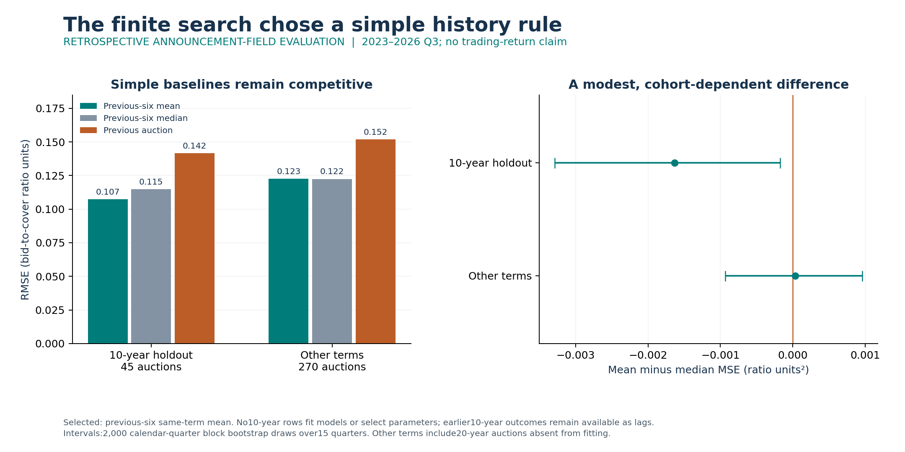
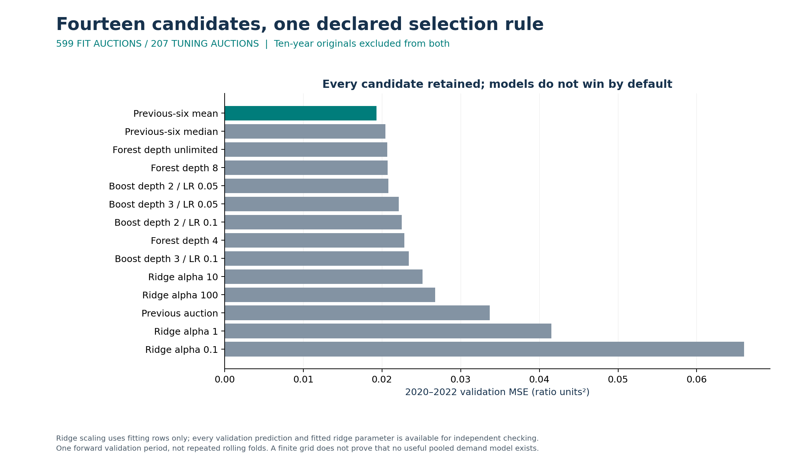
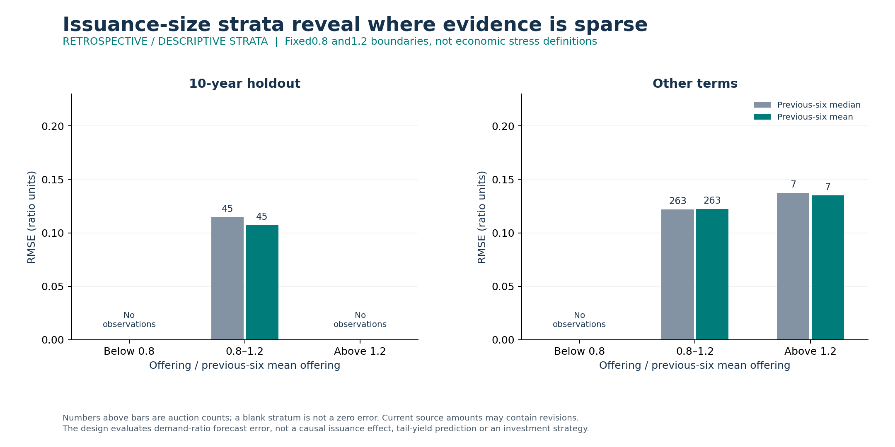

# Auction demand: a simple baseline earns the selection

**The previous-six same-maturity mean beat every fitted model in the declared validation comparison.** Its later performance improves modestly on the median for a maturity excluded from fitting and selection, while the two history rules are essentially tied for other maturities. The practical choice is a transparent reference forecast while a more demanding, vintage-aware model earns its added complexity.

This is a retrospective analysis of official Treasury aggregate auction statistics. Current historical responses do not establish the values available at first release. Outcomes are bid-to-cover ratios; no trading return, causal issuance effect or realized financial benefit is measured.



| 2023–2026 Q3 cohort | Auctions | Six-mean RMSE | Six-median RMSE | Previous-auction RMSE |
| --- | --- | --- | --- | --- |
| 10-year originals, excluded from fitting and selection | 45 | 0.1074 | 0.1147 | 0.1416 |
| Other original maturities | 270 | 0.1225 | 0.1224 | 0.1518 |

Units are bid-to-cover ratio units. The selected mean's MSE difference versus the median is −0.00163 on 10-year auctions, with a conditional 95% quarter-block bootstrap interval of −0.00329 to −0.00018. For other terms it is +0.00003, with interval −0.00093 to +0.00096. These are modest, cohort-dependent results across 15 test quarters.

## Why this comparison matters

Auction-size and demand relationships are already studied: [GAO's 2026 debt-management report, Appendix II](https://www.gao.gov/assets/gao-26-107529.pdf), uses maturity and year fixed effects and explicitly limits causal and out-of-sample interpretations. This project asks a narrower forecasting question, with earlier-result lineage, a later test and a maturity excluded from parameter estimation. It makes no new-algorithm or exhaustive literature-gap claim.

No 10-year row fits a model or chooses a hyperparameter. Earlier 10-year outcomes remain available as lag features when their auction dates precede the current announcement. This is **parameter transfer**, not a cold start with no maturity history. The other-terms cohort includes 20-year auctions, which are absent from the fitting period and appear in tuning; term-level exports expose that difference.

## What was optimized and checked

The source query contains 6,046 auction records, including instruments outside the declared nominal note/bond family. Explicit filters, missing-value handling and six-earlier-result requirements leave 599 fitting auctions, 207 tuning auctions, 315 test auctions and separate warmup/history-only rows. Source keys, dates, flags, units, exclusions and response hashes reconcile.

Fourteen candidates comprise three historical baselines, four standardized ridge penalties, three random-forest depths and four histogram-boosting settings. Fitting uses 2010–2019 and selection uses 2020–2022, both excluding 10-year originals. A single forward validation period selects the lowest auction MSE; it does not establish a global optimum or repeated-fold stability. Every trial, runtime and validation prediction is retained. Only the selected rule and the three declared baselines receive the final test; the result does not imply that every possible pooled model would fail.



Current result fields—accepted/tendered totals, yields, bidder shares and the outcome—are excluded from predictors. The allowed current fields concern the announced offer, dates, maturity and reopening. Earlier result features require `prior auction date < current announcement date`, excluding unresolved same-day timing. An independent [SQL reconstruction](sql/eligible_history.sql) checks every exported history identity and feature. Four ridge models also have independently reconstructed train-only means/scales and scalar prediction equations.

The reported Treasury ratio excludes Federal Reserve own-account bids/awards; naively dividing unadjusted accepted and tendered totals can use a different denominator. This study retains the official reported ratio as the target. [Source definitions](SOURCES.md) and [the declared protocol](PROTOCOL.md) explain the boundary.

## Size changes and next experiment



All 45 held-out 10-year test auctions fall within 0.8–1.2 times their previous-six average offering. Only seven other-term auctions exceed 1.2, and none in either cohort falls below 0.8. That is inadequate evidence for broad transfer across large issuance-size changes. Empty groups remain empty rather than being displayed as zero error.

The next experiment should add verified announcement vintages and more genuinely unusual offering changes, then test a prespecified model on new dates. Current data do not support a causal issuance-size effect or a market strategy. No private participant or account records are used.

## Reproduce

Python 3.10 with pinned dependencies:

```text
pip install -r requirements.txt
python src/retrieve.py
python -m unittest discover -s tests -v
python src/check_reproduction.py
```

The replay runs in a temporary directory. It rebuilds every feature, refits all 14 candidates, checks all candidate losses and the frozen selection at 1e-7 absolute / 1e-9 relative tolerance, evaluates the 315 test auctions and independently reconstructs all 36 metric/stratum rows and 4,000 quarter-block bootstrap draws. Five contracts check availability, lag count, maturity isolation and result-field exclusion. A bounded publication scan checks intended files; it is not universal secret detection.

[Search](results/search.csv) · [Frozen selection](results/selection.json) · [Test results](results/test_summary.json) · [Independent checks](results/verification_test.json) · [Model-validation standard](MODEL_VALIDATION_STANDARD.md)

Raw API responses, binary fitted models, source papers and private manuscript drafts are excluded from GitHub. Original code and derived evidence are public; reproducibility retrieves the exact hashed official source. The private LaTeX manuscript remains an unpublished working draft.
